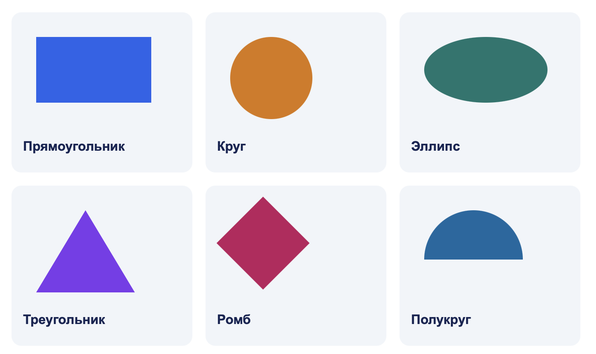
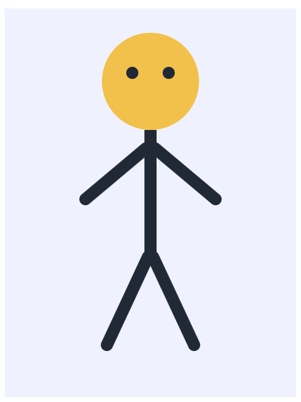

# CSS: построение макета

В этом материале разбираются поток документа, расположение и вложенность блоков, координаты, рисунки из CSS и оформление табличных данных

Подключение CSS, селекторы, единицы, цвета, шрифты, размеры и состояния подробно разобраны в [теории 04](04-css-foundations.md)

## Содержание

- [Поток и дерево документа](#поток-и-дерево-документа)
- [Свойство display](#свойство-display)
- [Блоки в строке и переносы](#блоки-в-строке-и-переносы)
- [Размер контейнера и отступы](#размер-контейнера-и-отступы)
- [Позиционирование](#позиционирование)
- [Наложение и обрезка](#наложение-и-обрезка)
- [Фигуры из CSS](#фигуры-из-css)
- [Поворот и точка опоры](#поворот-и-точка-опоры)
- [Оформление таблиц](#оформление-таблиц)
- [Один CSS для нескольких страниц](#один-css-для-нескольких-страниц)
- [Flexbox для следующих работ](#flexbox-для-следующих-работ)
- [Grid для следующих работ](#grid-для-следующих-работ)
- [Отладка расположения](#отладка-расположения)

## Поток и дерево документа

Браузер размещает содержимое в обычном потоке: блоки идут друг за другом, строки текста заполняются по ширине. Если абзац становится длиннее, он занимает больше места и сдвигает следующие блоки

`div` - универсальный контейнер без специального смыслового назначения. Для головы рисунка или группы декоративных элементов он подходит; для навигации и основной области документа сохраняйте `nav` и `main`

```html
<div class="face">
  <div class="eye eye-left"></div>
  <div class="eye eye-right"></div>
</div>
```

Здесь глаза - дочерние элементы лица и соседи друг другу. Вложенность выражает принадлежность: перемещая лицо вместе с его содержимым, мы перемещаем оба глаза. Эта связь задается HTML-деревом

Декоративные детали не должны превращаться в десятки остановок клавиатуры. Не добавляйте им `tabindex`. Рисунок можно представить как одно изображение: контейнеру задать `role="img"` и понятное `aria-label`

## Свойство display

`display` задает участие элемента в раскладке. Семантика HTML при этом не меняется: ссылка с `display: block` остается ссылкой

| Значение       | Как располагается элемент                                   | Размеры                                                                             |
| -------------- | ----------------------------------------------------------- | ----------------------------------------------------------------------------------- |
| `block`        | Начинает новый блок, в обычном потоке следует за предыдущим | При `width: auto` обычно занимает доступную ширину; поддерживает `width` и `height` |
| `inline`       | Участвует в строке вместе с текстом                         | У обычного текстового `span` ширина и высота через `width` / `height` не задаются   |
| `inline-block` | Цельный блок внутри строки; может переноситься целиком      | Поддерживает ширину, высоту, внутренние отступы и границы                           |
| `none`         | Не создает коробку, не занимает места                       | Скрывает и вложенное содержимое, в том числе для вспомогательных технологий         |
| `flex`         | Дочерние элементы раскладываются по главной оси             | Управляется flex-алгоритмом                                                         |
| `grid`         | Дочерние элементы занимают ячейки сетки                     | Управляется строками и столбцами                                                    |

У `img` есть собственные размеры; `width` / `height` работают при строчном отображении

`visibility: hidden` скрывает содержимое и сохраняет его место в раскладке. `opacity: 0` только делает его прозрачным: элемент может продолжать получать фокус и реагировать на мышь

## Блоки в строке и переносы

Элементы `inline-block` заполняют строку слева направо, пока хватает места. Следующий элемент переходит на новую строку. Перенос происходит в потоке, HTML-дерево сохраняется

Пример с тремя метками:

```html
<div class="tags">
  <div class="tag">HTML</div>
  <div class="tag">CSS</div>
  <div class="tag">Дизайн</div>
</div>
```

```css
.tags {
  width: 240px;
  font-size: 0;
}
.tag {
  display: inline-block;
  vertical-align: top;
  box-sizing: border-box;
  width: 100px;
  padding: 8px;
  border: 1px solid #64748b;
  font-size: 16px;
}
```

В первой строке поместятся две метки, третья перенесется. Пробелы и переводы строк между тегами обычно дают видимый пробел между `inline-block`. `font-size: 0` у контейнера убирает его ширину; дочерним элементам необходимо вернуть читаемый размер шрифта. В этом приеме размеры ячеек лучше задавать в `px`, поскольку единицы `em` зависят от шрифта

По умолчанию `inline-block` выравнивается по базовой линии текста. Если блоки содержат разное число строк, их верхние края могут не совпасть; `vertical-align: top` выравнивает их по верху строки

Для расчета количества элементов учитывайте ширину коробки, границы, `padding`, `margin` и пробелы. При `border-box` граница и внутренний отступ включены в `width`; внешний отступ учитывается дополнительно

`white-space: nowrap` на контейнере запрещает переносы и может создать переполнение. Для поля с переносами оставляйте обычное поведение. `<br>` предназначен для смыслового разрыва строки текста

Изображение можно сделать блочным и отделить от подписи: `display: block; margin: 0 auto 8px`. Для иконок подходит `object-fit: contain`, для фотографий с заполнением области - `object-fit: cover`. Высота строки текста должна оставаться обычной: попытка центрировать всю ячейку огромным `line-height` ломается на многострочной подписи

## Размер контейнера и отступы

```css
main {
  width: 960px;
  margin: 0 auto;
}
```

Если родитель шире, свободное горизонтальное пространство делится между двумя автоматическими отступами. Так центрируется блочная коробка. `text-align: center` выравнивает строчное содержимое внутри коробки

У обычного блока высота `auto` зависит от содержимого. Фиксированная высота полезна для сцены рисунка. В текстовом разделе она может вызвать переполнение

Вертикальные внешние отступы соседних обычных блоков могут схлопываться: итоговое расстояние равно большему из двух положительных отступов. Верхний отступ первого дочернего блока иногда схлопывается с отступом родителя. Внутренний `padding` не схлопывается; `display: flow-root` создает отдельный контекст форматирования и препятствует схлопыванию отступов родителя с детьми

## Позиционирование

`position` определяет способ размещения, а `top`, `right`, `bottom`, `left` - смещения или расстояния до границ опорной области

| Значение   | Место в потоке   | Откуда берутся координаты                                                         |
| ---------- | ---------------- | --------------------------------------------------------------------------------- |
| `static`   | Сохраняется      | Обычный поток; координатные свойства не действуют                                 |
| `relative` | Сохраняется      | Смещение от исходного положения элемента                                          |
| `absolute` | Не резервируется | От содержащего блока, обычно ближайшего предка с `position`, отличным от `static` |
| `fixed`    | Не резервируется | Обычно от области просмотра браузера                                              |
| `sticky`   | Сохраняется      | Поток с ограниченным смещением при прокрутке                                      |

### Relative и absolute вместе

```html
<div class="scene">
  <div class="face">
    <div class="eye"></div>
  </div>
</div>
```

```css
.scene {
  position: relative;
  width: 300px;
  height: 220px;
  background-color: #e0f2fe;
}
.face {
  position: absolute;
  left: 70px;
  top: 40px;
  width: 120px;
  height: 120px;
  border-radius: 50%;
  background-color: #fbbf24;
}
.eye {
  position: absolute;
  left: 30px;
  top: 35px;
  width: 14px;
  height: 14px;
  border-radius: 50%;
  background-color: #111827;
}
```

`scene` задает опору для лица; лицо с `position: absolute` само задает опору для глаза. У глаза `left: 30px` считается от лица. Для обычного позиционированного предка опорная область включает его `padding`; в примере отступов и границ нет, поэтому начало координат очевидно

`relative` без координат не сдвигает сцену. Если задать самой сцене `left: 20px`, она визуально переместится с сохранением прежнего места в потоке

Абсолютные дети не увеличивают высоту родителя. Если внутри сцены только такие элементы, задайте ей размеры, иначе следующий текст может оказаться поверх рисунка

Не нужно назначать `relative` всем промежуточным оберткам: ближайшая такая обертка изменит точку отсчета координат. Некоторые другие свойства, например `transform`, тоже создают содержащий блок; это особенно важно при поиске неожиданного поведения `fixed`. [Подробности о содержащем блоке в MDN](https://developer.mozilla.org/en-US/docs/Web/CSS/Guides/Display/Containing_block)

### Проценты и центрирование

Для абсолютного элемента `left: 50%` отсчитывает половину ширины содержащего блока. Это ставит в середину левый край элемента

```css
.badge {
  position: absolute;
  left: 50%;
  top: 50%;
  transform: translate(-50%, -50%);
}
```

Проценты в `translate` относятся к размеру самого перемещаемого элемента: он отодвигается назад на половину собственной ширины и высоты. Не путайте две разные базы расчета

### Fixed и sticky

`fixed` подходит, например, для постоянной кнопки у края окна. Учитывайте возможное перекрытие содержимого; основное содержимое страницы размещайте в обычном потоке

```css
.section-nav {
  position: sticky;
  top: 0;
  background-color: white;
  z-index: 1;
}
```

Такой блок идет в потоке, затем удерживается у верхнего края своей области прокрутки, пока позволяют границы содержащего блока. Без порога вроде `top: 0` прилипания по этой оси не будет. Прокручиваемый предок с `overflow` влияет на то, к какой области привязывается элемент; если места для прокрутки нет, эффект незаметен

## Наложение и обрезка

Когда детали пересекаются, порядок HTML часто определяет, какая окажется сверху: более поздний позиционированный сосед обычно рисуется поверх предыдущего при одинаковом уровне наложения

```css
.back-ear {
  position: absolute;
  z-index: 1;
}
.face {
  position: absolute;
  z-index: 2;
}
.front-paw {
  position: absolute;
  z-index: 3;
}
```

`z-index` управляет порядком в контексте наложения. У обычного статичного блока он не действует; отдельное исключение - flex- и grid-элементы. Позиционированный элемент с `z-index`, отличным от `auto`, создает свой контекст; его ребенок с огромным `z-index` не может вырваться поверх соседнего контекста более высокого уровня. Контекст создают также `transform` и `opacity` меньше `1`

Для простого рисунка сначала исправьте порядок деталей и вложенность, затем при необходимости добавьте небольшие значения `z-index`

`overflow: hidden` обрезает выходящие части. Если у головы так обрезаны уши, нужно изменить устройство рисунка или убрать обрезку. `border-radius` скругляет коробку и ее фон. Для обрезки дочерних элементов дополнительно задайте `overflow: hidden`

## Фигуры из CSS

У каждой фигуры ниже один пустой `div`. Цвет, граница и скругление превращают прямоугольную коробку в видимую фигуру



Скриншот [страницы с теми же примерами](assets/css-layout/shapes.html)

### Прямоугольник

```html
<div class="rectangle"></div>
```

```css
.rectangle {
  width: 140px;
  height: 80px;
  background-color: #2563eb;
}
```

У прямоугольника разные ширина и высота; при равных значениях получится квадрат

### Круг

```html
<div class="circle"></div>
```

```css
.circle {
  width: 100px;
  height: 100px;
  background-color: #d97706;
  border-radius: 50%;
}
```

Для круга нужны одинаковые ширина и высота. `border-radius: 50%` при разных размерах даст эллипс

### Эллипс

```html
<div class="ellipse"></div>
```

```css
.ellipse {
  width: 150px;
  height: 80px;
  background-color: #0f766e;
  border-radius: 50%;
}
```

Скругление на половину каждой стороны формирует эллипс с заданными шириной и высотой

### Треугольник

```html
<div class="triangle"></div>
```

```css
.triangle {
  width: 0;
  height: 0;
  border-left: 60px solid transparent;
  border-right: 60px solid transparent;
  border-bottom: 100px solid #7c3aed;
}
```

У содержимого нулевая площадь. Границы встречаются по диагонали: нижняя цветная граница образует треугольник, боковые прозрачные задают его половины ширины. Видимая ширина здесь 120px, высота 100px; `background-color` такой треугольник не окрашивает

### Ромб

```html
<div class="diamond"></div>
```

```css
.diamond {
  width: 80px;
  height: 80px;
  background-color: #be185d;
  transform: rotate(45deg);
}
```

Квадрат повернут на 45 градусов. Видимый рисунок выходит за исходные 80px: поворот не перерасчитывает место, выделенное соседями в потоке

### Полукруг

```html
<div class="semicircle"></div>
```

```css
.semicircle {
  width: 120px;
  height: 60px;
  background-color: #0369a1;
  border-radius: 60px 60px 0 0;
}
```

Скруглены только верхние углы. Высота равна половине ширины; нижняя сторона остается прямой

### Из фигур в рисунок

Круг может стать головой, узкий прямоугольник - рукой, треугольник - крышей или носом. Сначала определите дерево принадлежности, затем размеры крупных частей и только после этого координаты мелких деталей



[Исходная страница человека](assets/css-layout/person.html) также приведена целиком в [лабораторной 5](labs/lab5.md#пример-человек). У головы и туловища свои дочерние элементы, поэтому координаты деталей остаются локальными

Рисунок из `div` помогает изучить коробки, координаты и вложенность

## Поворот и точка опоры

```css
.arm {
  width: 10px;
  height: 70px;
  transform-origin: top center;
  transform: rotate(35deg);
}
```

По умолчанию элемент поворачивается вокруг центра. `transform-origin: top center` переносит опору в середину верхней стороны: так рука поворачивается от плеча

Преобразование меняет видимое положение элемента и его детей. Соседи сохраняют свое место в потоке. При нескольких преобразованиях порядок функций важен. Повторное объявление `transform` заменяет предыдущее целиком, поэтому нужные функции записывают вместе, например `transform: translateX(-50%) rotate(15deg)`

## Оформление таблиц

Расписание содержит табличные данные: используйте `table`, `tr`, `th` и `td` с их стандартным табличным отображением. CSS оформляет таблицу с сохранением связи заголовков и данных

```css
.schedule table {
  width: 100%;
  border-collapse: collapse;
  margin-bottom: 24px;
}
.schedule th,
.schedule td {
  padding: 12px;
  border: 1px solid #94a3b8;
  vertical-align: top;
  text-align: left;
}
.schedule caption {
  text-align: left;
  font-weight: bold;
  margin-bottom: 8px;
}
.schedule thead th {
  color: white;
  background-color: #1e3a5f;
}
```

`border-collapse: collapse` объединяет соприкасающиеся границы в одну. При `separate` границы остаются раздельными, а расстояние между ними задает `border-spacing`; с `collapse` это расстояние не применяется

```css
.schedule tbody tr:nth-child(even) td {
  background-color: #eef2ff;
}
.schedule tbody td.no-classes {
  text-align: center;
  font-style: italic;
  background-color: #fef3c7;
}
.schedule tbody tr:hover td {
  background-color: #dbeafe;
}
```

Чередование начинается заново в каждом `tbody`. Здесь фон назначается ячейкам, которые рисуются поверх фона строки. Правило наведения идет после чередования, при равной специфичности оно побеждает. У последнего правила специфичность выше, чем у правила `no-classes`, поэтому наведение видно и в дне без пар

Объединенная через `colspan="4"` ячейка занимает четыре столбца и представлена одним элементом в DOM. Для ее оформления используйте отдельный класс

### Ширина столбцов

При `table-layout: auto` браузер учитывает содержимое всех ячеек. Длинные названия влияют на распределение ширины. При `table-layout: fixed` и заданной ширине таблицы расчет опирается на явные ширины столбцов или первую строку; оставшееся пространство распределяется между столбцами

Для одинаковых столбцов нескольких отдельных таблиц можно добавить в каждую одинаковый `colgroup` после `caption` и перед `thead`, а ширину задать классам `col`

```html
<colgroup>
  <col class="time-column" />
  <col class="subject-column" />
  <col class="room-column" />
  <col class="teacher-column" />
</colgroup>
```

```css
.schedule table {
  table-layout: fixed;
}
.time-column {
  width: 18%;
}
.subject-column {
  width: 34%;
}
.room-column {
  width: 14%;
}
.teacher-column {
  width: 34%;
}
```

У `col` ограниченный набор применимых свойств. Выравнивание текста и `padding` задавайте самим `th` / `td`, например через `:nth-child(3)`. Для длинных слов применяют `overflow-wrap: anywhere`, а для интервала времени - `white-space: nowrap`; последнее может привести к переполнению, если ширины недостаточно

## Один CSS для нескольких страниц

Для проекта с `css/styles.css`, страницами в `schedule` и вложенными страницами в `schedule/subjects` пути отличаются:

| Где находится HTML  | Значение `href` у `link rel="stylesheet"` |
| ------------------- | ----------------------------------------- |
| Корень проекта      | `css/styles.css`                          |
| `schedule`          | `../css/styles.css`                       |
| `schedule/subjects` | `../../css/styles.css`                    |

Путь в `link` считается от HTML-документа. Путь внутри `url(...)` внешнего CSS считается от самого CSS-файла

Добавьте странице класс, например `<body class="schedule">`, и ограничивайте специальные правила этим классом. Общие шрифты и навигация могут использоваться везде, а `.schedule td` и `.drawing .eye` не будут мешать друг другу

Один внешний файл позволяет изменить фон или цвет заголовков сразу на всех страницах. Изменение только во вкладке `Styles` временное: после перезагрузки оно исчезнет, если не перенести его в файл

## Flexbox для следующих работ

Flexbox удобно распределяет элементы вдоль одной главной оси. Объявление на родителе делает только непосредственных детей flex-элементами

```html
<div class="toolbar">
  <a href="index.html">Главная</a>
  <a href="gallery.html">Галерея</a>
  <a href="contacts.html">Контакты</a>
</div>
```

```css
.toolbar {
  display: flex;
  flex-direction: row;
  justify-content: space-between;
  align-items: center;
  gap: 16px;
}
```

Главная ось определяется `flex-direction`: `row` идет вдоль строки, `column` - сверху вниз в обычном горизонтальном письме. `justify-content` распределяет свободное место вдоль главной оси, `align-items` выравнивает по поперечной. `gap` задает промежутки между соседями без внешних отступов по краям контейнера

| Свойство элемента | Назначение                                                       |
| ----------------- | ---------------------------------------------------------------- |
| `flex-grow`       | Доля оставшегося положительного свободного места                 |
| `flex-shrink`     | Участие в сжатии при недостатке места, с учетом базового размера |
| `flex-basis`      | Исходный размер вдоль главной оси                                |
| `align-self`      | Индивидуальное выравнивание по поперечной оси                    |
| `order`           | Визуальная очередность                                           |

`flex: 1` обычно используют для распределения доступного места между элементами; это сокращенная запись свойств flex-элемента. Длинное содержимое может ограничить сжатие: стандартный минимальный размер flex-элемента часто зависит от содержимого, поэтому иногда нужен `min-width: 0`

По умолчанию все элементы находятся в одной flex-линии. `flex-wrap: wrap` разрешает дополнительные линии, `align-content` распределяет эти линии по поперечной оси при наличии свободного места. `align-items` работает с элементами внутри линии

`order` и обратное направление не исправляют порядок чтения документа и клавиатурного обхода. Сначала задавайте логичный порядок HTML, затем оформляйте его

## Grid для следующих работ

Grid задает строки и столбцы одновременно. Удобен для выравнивания элементов по строкам и столбцам

```css
.gallery {
  display: grid;
  grid-template-columns: repeat(3, 180px);
  grid-auto-rows: 120px;
  gap: 16px;
}
.gallery .large {
  grid-column: span 2;
}
```

Три явных столбца имеют ширину 180px. Новые строки создаются автоматически высотой 120px. Элемент с `span 2` занимает два столбца вместе с промежутком между ними

Для распределения оставшегося пространства применяют `fr`, например `grid-template-columns: 1fr 2fr`. Это доли свободного пространства с отдельным учетом промежутков. Минимальный размер содержимого может мешать сжатию; `minmax(0, 1fr)` разрешает треку уменьшаться до нуля. Проверяйте возможное переполнение содержимого

Линии сетки нумеруются начиная с 1. `grid-column: 1 / 3` размещает элемент между первой и третьей линиями, то есть на двух столбцах. Аналогично работает `grid-row`

`justify-items` и `align-items` выравнивают элементы внутри ячеек, а `justify-content` и `align-content` - всю сетку внутри контейнера, если остается свободное место. Абсолютные координаты для каждого элемента такой сетки не нужны

Flexbox и Grid решают задачи раскладки страницы. Табличные данные расписания оформляйте через `table`

## Отладка расположения

| Наблюдение                                   | Что проверить                                                            |
| -------------------------------------------- | ------------------------------------------------------------------------ |
| Глаз уехал в угол страницы                   | Есть ли позиционированная голова среди предков                           |
| Следующий текст накрыл рисунок               | Не состоит ли родитель только из абсолютных детей без собственной высоты |
| В строке на одну ячейку меньше               | Пробелы между `inline-block`, `box-sizing`, границы и внешние отступы    |
| Верхние края карточек расходятся             | `vertical-align` и базовую линию                                         |
| Цвет четной строки не меняется при наведении | Какому элементу назначен фон, специфичность и порядок правил             |
| CSS не загружается на странице предмета      | Число `../` в пути к файлу                                               |
| Большой `z-index` не помогает                | Контексты наложения предков                                              |
| Повернутый элемент перекрыл соседний         | Поворот не меняет место, занятое коробкой в потоке                       |

В `Elements` проверьте дерево, в `Styles` - активные и перечеркнутые объявления, в `Computed` - итоговые размеры и координаты. Для Grid и Flexbox браузер предлагает специальные наложения с линиями и промежутками. В `Network` проверьте, что общий CSS и изображения загрузились без ошибок

Поведение обычного потока подробнее описано в [MDN: блочная и строчная раскладка](https://developer.mozilla.org/en-US/docs/Web/CSS/Guides/Display/Block_and_inline_layout)
