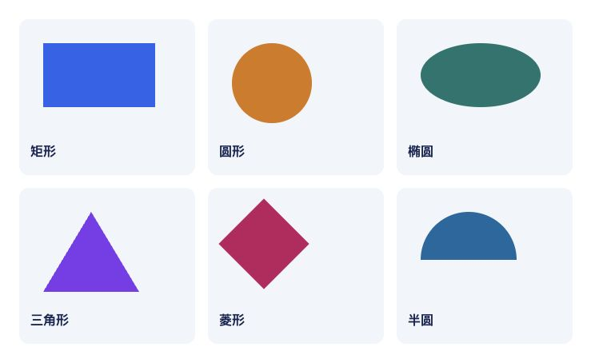
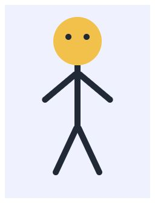

# CSS：构建布局

本材料介绍文档流、盒子的排列与嵌套、坐标、CSS 绘图以及表格数据的样式

实验作业 5 需要文档流、inline-block、定位、图形和表格知识。Flexbox 与 Grid 章节供后续作业使用

CSS 的引入、选择器、单位、颜色、字体、尺寸和状态详见[理论 04](04-css-foundations_cn.md)

## 目录

- [文档流与文档树](#文档流与文档树)
- [display 属性](#display-属性)
- [行内盒子与换行](#行内盒子与换行)
- [容器尺寸与间距](#容器尺寸与间距)
- [定位](#定位)
- [层叠与裁剪](#层叠与裁剪)
- [CSS 图形](#css-图形)
- [旋转与变换原点](#旋转与变换原点)
- [表格样式](#表格样式)
- [多个页面共用 CSS](#多个页面共用-css)
- [后续作业中的 Flexbox](#后续作业中的-flexbox)
- [后续作业中的 Grid](#后续作业中的-grid)
- [布局调试](#布局调试)

## 文档流与文档树

浏览器通过正常文档流排列内容：块依次排列，文字按可用宽度填充各行。段落变长时，占用的空间增大，后续块随之移动

`div` 是没有特定语义的通用容器，适合绘图中的头部或一组装饰元素；导航和文档主要内容区域继续使用 `nav` 和 `main`

```html
<div class="face">
  <div class="eye eye-left"></div>
  <div class="eye eye-right"></div>
</div>
```

这里的眼睛是脸部的子元素，两只眼睛互为兄弟元素。嵌套表达归属关系：移动脸部及其内容时，两只眼睛一起移动。这一关系由 HTML 树决定

装饰部件无需成为大量键盘焦点停靠点，不要为它们添加 `tabindex`。可以将整个图案表示为一张图像：为容器设置 `role="img"` 和清晰的 `aria-label`

## display 属性

`display` 决定元素如何参与布局。HTML 语义保持不变：设置了 `display: block` 的链接仍然是链接

| 值             | 元素如何排列                               | 尺寸                                                       |
| -------------- | ------------------------------------------ | ---------------------------------------------------------- |
| `block`        | 开始一个新的块，在正常流中位于前一个块之后 | `width: auto` 时通常占据可用宽度；支持 `width` 和 `height` |
| `inline`       | 与文字一起参与行内排列                     | 普通文字 `span` 的宽高不能通过 `width` / `height` 设置     |
| `inline-block` | 作为完整盒子参与行内排列，可以整体换行     | 支持宽高、内边距和边框                                     |
| `none`         | 不生成盒子，不占据空间                     | 同时隐藏内部内容，辅助技术也无法读取它                     |
| `flex`         | 子元素沿主轴排列                           | 由 Flexbox 布局算法控制                                    |
| `grid`         | 子元素占据网格单元                         | 由行和列控制                                               |

`img` 有自身尺寸；在行内显示时，`width` / `height` 也能生效

`visibility: hidden` 隐藏内容并保留其布局空间。`opacity: 0` 使内容透明：元素仍可能获得焦点并响应鼠标

## 行内盒子与换行

`inline-block` 元素在空间足够时从左到右填充一行，下一个放不下的元素移到新行。换行发生在文档流中，HTML 树保持原样

三个标签的示例：

```html
<div class="tags">
  <div class="tag">HTML</div>
  <div class="tag">CSS</div>
  <div class="tag">设计</div>
</div>
```

```css
.tags {
  width: 240px;
  font-size: 0;
}
.tag {
  display: inline-block;
  vertical-align: top;
  box-sizing: border-box;
  width: 100px;
  padding: 8px;
  border: 1px solid #64748b;
  font-size: 16px;
}
```

第一行放下两个标签，第三个换行。标签之间的空格和源代码换行通常会在 `inline-block` 之间产生可见空隙。容器的 `font-size: 0` 将这些空白的宽度归零；子元素必须恢复为可读字号。采用此方法时，格子尺寸适合使用 `px`，因为 `em` 依赖字号

默认情况下，`inline-block` 按文字基线对齐。如果盒子中的文字行数不同，顶边可能无法对齐；`vertical-align: top` 将它们按行的顶部对齐

计算一行容纳的元素数量时，应考虑盒子宽度、边框、`padding`、`margin` 和空白。使用 `border-box` 时，边框与内边距包含在 `width` 内，外边距另外计算

容器上的 `white-space: nowrap` 禁止换行，可能造成溢出。需要换行的区域保留默认行为。`<br>` 用于文字内容中有语义的换行

可以将图片设为块级，并与文字拉开距离：`display: block; margin: 0 auto 8px`。图标适合 `object-fit: contain`，填满图片区域的照片适合 `object-fit: cover`。文字应保持正常行高：用很大的 `line-height` 将整个格子内容居中的做法，在文字有多行时会失效

## 容器尺寸与间距

```css
main {
  width: 960px;
  margin: 0 auto;
}
```

如果父元素更宽，水平方向的剩余空间会分配给两侧的自动外边距，从而使块盒子居中。`text-align: center` 将盒子内部的行内内容居中

普通块的 `auto` 高度取决于内容。固定高度适合绘图场景；用于文字区域时可能造成溢出

相邻普通块的垂直外边距可能发生折叠：两个正外边距形成的最终距离等于其中较大的值。第一个子块的上外边距有时也会与父元素的外边距折叠。内边距 `padding` 不折叠；`display: flow-root` 创建独立的格式化上下文，可阻止父元素与子元素之间的外边距折叠

## 定位

`position` 决定定位方式，`top`、`right`、`bottom`、`left` 设置偏移量或到参照区域边缘的距离

| 值         | 是否保留流中的空间 | 坐标依据                                                     |
| ---------- | ------------------ | ------------------------------------------------------------ |
| `static`   | 保留               | 正常文档流；坐标属性不生效                                   |
| `relative` | 保留               | 相对于元素原始位置的偏移                                     |
| `absolute` | 不预留             | 相对于包含块，通常由最近的 `position` 非 `static` 的祖先建立 |
| `fixed`    | 不预留             | 通常相对于浏览器视口                                         |
| `sticky`   | 保留               | 正常流与滚动时受限制的偏移                                   |

### 配合使用 relative 和 absolute

```html
<div class="scene">
  <div class="face">
    <div class="eye"></div>
  </div>
</div>
```

```css
.scene {
  position: relative;
  width: 300px;
  height: 220px;
  background-color: #e0f2fe;
}
.face {
  position: absolute;
  left: 70px;
  top: 40px;
  width: 120px;
  height: 120px;
  border-radius: 50%;
  background-color: #fbbf24;
}
.eye {
  position: absolute;
  left: 30px;
  top: 35px;
  width: 14px;
  height: 14px;
  border-radius: 50%;
  background-color: #111827;
}
```

`scene` 是脸部的定位参照；设置了 `position: absolute` 的脸部又成为眼睛的定位参照。眼睛的 `left: 30px` 从脸部计算。对于普通定位祖先，参照区域包含其 `padding`；本例没有内边距和边框，因此坐标起点很直观

没有坐标偏移的 `relative` 不会移动场景。如果给场景本身设置 `left: 20px`，它会在视觉上移动，并保留原来在文档流中的空间

绝对定位的子元素不会增加父元素的高度。如果场景内部只有这类元素，需要为场景设置尺寸，否则后续文字可能覆盖图案

为中间容器添加 `relative` 时要注意：最近的定位容器会改变坐标参照点。某些其他属性，例如 `transform`，也会建立包含块；排查 `fixed` 的异常表现时尤其需要关注这一点。[MDN：包含块详解](https://developer.mozilla.org/en-US/docs/Web/CSS/Guides/Display/Containing_block)

### 百分比与居中

对于绝对定位元素，`left: 50%` 取包含块宽度的一半，使元素的左边缘位于中间

```css
.badge {
  position: absolute;
  left: 50%;
  top: 50%;
  transform: translate(-50%, -50%);
}
```

`translate` 中的百分比相对于被移动元素自身的尺寸：元素向回移动自身宽度和高度的一半。这里涉及两个不同的百分比计算基准

### Fixed 和 sticky

`fixed` 适合放置窗口边缘的常驻按钮。注意它可能覆盖内容；页面主要内容应放在正常文档流中

```css
.section-nav {
  position: sticky;
  top: 0;
  background-color: white;
  z-index: 1;
}
```

这个块先参与正常流，然后在包含块边界允许的范围内，保持在所属滚动区域的顶部。必须设置 `top: 0` 之类的阈值，才能产生对应轴上的粘性效果。带有 `overflow` 的可滚动祖先会影响元素所依附的滚动区域；没有滚动空间时，效果不明显

## 层叠与裁剪

部件相互重叠时，HTML 顺序经常决定谁在上方：层级相同时，较后出现的定位兄弟元素通常绘制在前一个元素上方

```css
.back-ear {
  position: absolute;
  z-index: 1;
}
.face {
  position: absolute;
  z-index: 2;
}
.front-paw {
  position: absolute;
  z-index: 3;
}
```

`z-index` 控制层叠上下文内的顺序。它对普通静态块不生效；Flexbox 和 Grid 的项目是特殊情况。`z-index` 非 `auto` 的定位元素会创建自己的层叠上下文；其子元素即使设置很大的 `z-index`，也受该上下文的整体层级限制。`transform` 和小于 `1` 的 `opacity` 也会创建层叠上下文

对于简单图案，先调整部件顺序和嵌套关系，再按需要使用较小的 `z-index` 值

`overflow: hidden` 会裁掉超出的部分。如果头部的耳朵因此被裁切，需要调整图案结构或取消裁剪。`border-radius` 将盒子及其背景变为圆角；裁剪子元素时需另外设置 `overflow: hidden`

## CSS 图形

下面每个图形都使用一个空 `div`。颜色、边框和圆角将矩形盒子变成可见图形



[相同示例页面](assets/css-layout/shapes_cn.html)的截图

### 矩形

```html
<div class="rectangle"></div>
```

```css
.rectangle {
  width: 140px;
  height: 80px;
  background-color: #2563eb;
}
```

矩形的宽度和高度不同；两个值相等时得到正方形

### 圆形

```html
<div class="circle"></div>
```

```css
.circle {
  width: 100px;
  height: 100px;
  background-color: #d97706;
  border-radius: 50%;
}
```

圆形需要相同的宽度和高度。宽高不同时，`border-radius: 50%` 会形成椭圆

### 椭圆

```html
<div class="ellipse"></div>
```

```css
.ellipse {
  width: 150px;
  height: 80px;
  background-color: #0f766e;
  border-radius: 50%;
}
```

各方向按对应边长的一半进行圆角处理，形成具有指定宽高的椭圆

### 三角形

```html
<div class="triangle"></div>
```

```css
.triangle {
  width: 0;
  height: 0;
  border-left: 60px solid transparent;
  border-right: 60px solid transparent;
  border-bottom: 100px solid #7c3aed;
}
```

内容区域的面积为零。边框沿对角线相接：有颜色的下边框形成三角形，两侧透明边框分别决定宽度的一半。可见宽度为 120px，高度为 100px；这种三角形的颜色由边框决定，`background-color` 不会为它着色

### 菱形

```html
<div class="diamond"></div>
```

```css
.diamond {
  width: 80px;
  height: 80px;
  background-color: #be185d;
  transform: rotate(45deg);
}
```

正方形旋转 45 度。可见图形超出原来的 80px 范围；旋转不会重新计算文档流中为该盒子预留的空间

### 半圆

```html
<div class="semicircle"></div>
```

```css
.semicircle {
  width: 120px;
  height: 60px;
  background-color: #0369a1;
  border-radius: 60px 60px 0 0;
}
```

只将上方两个角设为圆角。高度等于宽度的一半，下边缘保持平直

### 组合图形

圆形可以作为头部，窄矩形可以作为手臂，三角形可以作为屋顶或鼻子。先确定各部件的嵌套关系，再设置主要部件的尺寸，最后设置小部件的坐标



[小人的源页面](assets/css-layout/person_cn.html)也完整列在[实验作业 5](labs/lab5_cn.md#示例小人)中。头部与躯干各自包含子元素，因此内部部件使用局部坐标

用 `div` 绘图有助于学习盒子、坐标和嵌套关系

## 旋转与变换原点

```css
.arm {
  width: 10px;
  height: 70px;
  transform-origin: top center;
  transform: rotate(35deg);
}
```

默认情况下，元素围绕中心旋转。`transform-origin: top center` 将原点移到上边缘中间，手臂就会从肩部旋转

变换改变元素及其子元素的可见位置，周围元素保留在文档流中的位置。使用多个变换时，函数顺序很重要。重新声明 `transform` 会替换之前的整个值，因此需要将各函数写在一起，例如 `transform: translateX(-50%) rotate(15deg)`

## 表格样式

课程表包含表格数据：使用 `table`、`tr`、`th` 和 `td`，保留它们默认的表格显示方式。CSS 在保留标题与数据对应关系的前提下设置表格外观

```css
.schedule table {
  width: 100%;
  border-collapse: collapse;
  margin-bottom: 24px;
}
.schedule th,
.schedule td {
  padding: 12px;
  border: 1px solid #94a3b8;
  vertical-align: top;
  text-align: left;
}
.schedule caption {
  text-align: left;
  font-weight: bold;
  margin-bottom: 8px;
}
.schedule thead th {
  color: white;
  background-color: #1e3a5f;
}
```

`border-collapse: collapse` 将相邻边框合并为一条。使用 `separate` 时，边框独立显示，间距由 `border-spacing` 设置；此间距不适用于 `collapse`

```css
.schedule tbody tr:nth-child(even) td {
  background-color: #eef2ff;
}
.schedule tbody td.no-classes {
  text-align: center;
  font-style: italic;
  background-color: #fef3c7;
}
.schedule tbody tr:hover td {
  background-color: #dbeafe;
}
```

每个 `tbody` 内都重新开始奇偶行计数。这里为单元格设置背景，单元格绘制在行背景上方。悬停规则写在交替背景规则之后，在选择器权重相同时生效。最后一条规则的权重也高于 `no-classes` 规则，因此无课日同样能显示悬停效果

通过 `colspan="4"` 合并的单元格占据四列，在 DOM 中对应一个元素。使用独立的类设置其样式

### 列宽

`table-layout: auto` 会让浏览器考虑所有单元格的内容，较长的名称会影响列宽分配。使用 `table-layout: fixed` 并设置表格宽度时，计算依据是明确指定的列宽或第一行，其余空间分配给剩余列

如果多个独立表格需要相同列宽，可以在每个表格的 `caption` 之后、`thead` 之前添加相同的 `colgroup`，并通过 `col` 的类设置宽度

```html
<colgroup>
  <col class="time-column" />
  <col class="subject-column" />
  <col class="room-column" />
  <col class="teacher-column" />
</colgroup>
```

```css
.schedule table {
  table-layout: fixed;
}
.time-column {
  width: 18%;
}
.subject-column {
  width: 34%;
}
.room-column {
  width: 14%;
}
.teacher-column {
  width: 34%;
}
```

适用于 `col` 的属性有限。文字对齐和 `padding` 应设置在 `th` / `td` 上，例如使用 `:nth-child(3)`。长单词可以使用 `overflow-wrap: anywhere`，时间区间可以使用 `white-space: nowrap`；宽度不足时，禁止换行可能导致溢出

## 多个页面共用 CSS

对于含有 `css/styles.css`、`schedule` 中的页面，以及 `schedule/subjects` 中的嵌套页面的项目，引入路径如下：

| HTML 所在位置       | `link rel="stylesheet"` 的 `href` 值 |
| ------------------- | ------------------------------------ |
| 项目根目录          | `css/styles.css`                     |
| `schedule`          | `../css/styles.css`                  |
| `schedule/subjects` | `../../css/styles.css`               |

`link` 中的路径相对于 HTML 文档计算。外部 CSS 中 `url(...)` 的路径相对于 CSS 文件本身计算

为页面添加类，例如 `<body class="schedule">`，并通过这个类限定专用规则。公共字体和导航样式可以在各页使用，`.schedule td` 和 `.drawing .eye` 分别限定自己的作用范围

同一个外部文件可以同时修改所有页面的背景或标题颜色。仅在 `Styles` 面板中进行的修改是临时的；将修改写入文件，才能在刷新后保留

## 后续作业中的 Flexbox

Flexbox 适合沿一条主轴分配元素。在父元素上声明后，只有其直接子元素成为 flex 项目

```html
<div class="toolbar">
  <a href="index.html">首页</a>
  <a href="gallery.html">图库</a>
  <a href="contacts.html">联系方式</a>
</div>
```

```css
.toolbar {
  display: flex;
  flex-direction: row;
  justify-content: space-between;
  align-items: center;
  gap: 16px;
}
```

主轴由 `flex-direction` 决定：在常见的横向书写方式下，`row` 沿行方向，`column` 从上到下。`justify-content` 沿主轴分配剩余空间，`align-items` 沿交叉轴对齐。`gap` 设置相邻项目之间的间隔，容器边缘不会因此增加外边距

| 项目属性      | 用途                                         |
| ------------- | -------------------------------------------- |
| `flex-grow`   | 分配剩余正空间的比例                         |
| `flex-shrink` | 空间不足时参与收缩的比例，计算时考虑基础尺寸 |
| `flex-basis`  | 沿主轴的基础尺寸                             |
| `align-self`  | 单个项目在交叉轴上的对齐方式                 |
| `order`       | 视觉排列顺序                                 |

`flex: 1` 通常用于在项目之间分配可用空间，是 flex 项目属性的简写。较长内容可能限制收缩：flex 项目的默认最小尺寸经常取决于内容，因此有时需要 `min-width: 0`

默认情况下，所有项目排列在同一条 flex 行上。`flex-wrap: wrap` 允许多行；有剩余空间时，`align-content` 沿交叉轴分配这些行。`align-items` 负责每一行内项目的对齐

`order` 和反向排列不会调整文档阅读顺序或键盘焦点顺序。先在 HTML 中安排合理的逻辑顺序，再设置外观

## 后续作业中的 Grid

Grid 同时定义行和列，适合按行、列对齐元素

```css
.gallery {
  display: grid;
  grid-template-columns: repeat(3, 180px);
  grid-auto-rows: 120px;
  gap: 16px;
}
.gallery .large {
  grid-column: span 2;
}
```

三个显式列各宽 180px。新增行自动创建，高度为 120px。带有 `span 2` 的元素占据两列及其间的间隔

使用 `fr` 分配剩余空间，例如 `grid-template-columns: 1fr 2fr`。这些数值表示剩余空间的份额，间隔单独计算。内容的最小尺寸可能限制收缩；`minmax(0, 1fr)` 允许轨道缩小到零，使用时应检查内容溢出

网格线从 1 开始编号。`grid-column: 1 / 3` 将元素放在第一条和第三条线之间，占据两列。`grid-row` 的用法相同

`justify-items` 和 `align-items` 设置网格单元内的项目对齐；容器有剩余空间时，`justify-content` 和 `align-content` 设置整个网格的对齐。网格中的各元素无需单独设置绝对坐标

Flexbox 和 Grid 用于页面布局。课程表的表格数据使用 `table`

## 布局调试

| 现象                        | 检查内容                                              |
| --------------------------- | ----------------------------------------------------- |
| 眼睛跑到页面角落            | 祖先中是否有已定位的头部                              |
| 后续文字覆盖图案            | 父元素是否只有绝对定位子元素且没有自身高度            |
| 每行少了一个格子            | `inline-block` 之间的空白、`box-sizing`、边框和外边距 |
| 卡片顶边不齐                | `vertical-align` 和基线                               |
| 偶数行悬停时颜色不变        | 背景设置在哪个元素上，以及选择器权重和规则顺序        |
| 课程介绍页没有加载 CSS      | 文件路径中 `../` 的数量                               |
| 很大的 `z-index` 也没有效果 | 祖先的层叠上下文                                      |
| 旋转后的元素覆盖相邻元素    | 旋转不会改变盒子在文档流中占用的空间                  |

在 `Elements` 中检查树结构，在 `Styles` 中检查生效和被划掉的声明，在 `Computed` 中检查最终尺寸与坐标。浏览器为 Grid 和 Flexbox 提供显示线条与间隔的布局覆盖层。在 `Network` 中检查公共 CSS 和图片是否成功加载

正常文档流的更多说明参见 [MDN：块级与行内布局](https://developer.mozilla.org/en-US/docs/Web/CSS/Guides/Display/Block_and_inline_layout)
